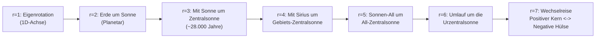
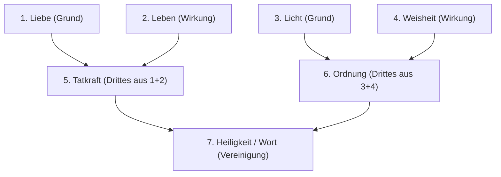

# Strukturelle Korpus-Befunde

*Systematische Auswertung des bereinigten Gesamtkorpus (1840–1864) nach 7-stufigen Hierarchien (*$r = 1\dots 7$*),* ${}(4 + 3 = 7){}$*-Zerlegungen,* ${}(1 + 7 = 8){}$*-Einbettungen und historischer Elektromagnetismus-Phänomenologie*

**Korpus-Übersicht:** [`README.md`](README.md) ($25$ Werke in hierarchischen Lese-Abschnitten unter [`md/`](md/))

---

## Methodische Vorbemerkung

Diese Auswertung untersucht die gemeinfreien Schriften Jakob Lorbers (1800–1864) nach **wiederkehrenden formalen Ordnungs-, Symmetrie- und Stufenmustern**. Sie erhebt keinen Anspruch darauf, aus historischen Texten des 19. Jahrhunderts moderne mathematische oder physikalische Sätze zu beweisen, sondern dokumentiert präzise und mit exakten Textbelegen, wo das Korpus selbst:
1. eine Zerlegung der Siebenheit in **$4$ Grundelemente und $3$ abgeleitete Verknüpfungen ($4 + 3 = 7$)** vornimmt,
2. die Siebenheit durch Hinzunahme der vereinigenden Einheit in die **Achtheit ($1 + 7 = 8 = 2 \times 4$)** einbettet,
3. eine selbstähnliche Durchdringung (**$7 \times 7 = 7^2$**) beschreibt und
4. die dreistufige Ordnung (*Sonne, Erde, Mond*) bis zur **siebenten Stufe ($r = 7$)** als rückwirkenden bzw. elektromagnetischen Abschluss zwischen innerem Kern und äußerer Hülle entfaltet.

---

## 1. Übersicht der Hauptbefunde

| # | Strukturmotiv | Primäre Belegstelle | Abschnitt in `md/` | Kernaussage im Originaltext |
| :---: | :--- | :--- | :--- | :--- |
| **1** | **7-stufige Kaskade ($r = 1\dots 7$) & Kern-Hüllen-Wechselreise** | `HIM/3/148/5–7` *(8. April 1864)* | [`md/HIM/b3/k141-160.md`](md/HIM/b3/k141-160.md) | Erweitert die 3er-Ordnung explizit auf **7 geschachtelte Reisen**; die **7. Reise** ist die *Wechselreise* zwischen **positivem Kern** (*Urzentralsonne*) und **negativer Hülle** (*Hülse der Globe*) durch die *beiden elektromagnetischen Urstoffe*. |
| **2** | **Erzeuger-Prüf-Zerlegung $4 + 3 = 7$** | `HG/2/252/8–17` *(Henoch-Rede)* | [`md/HG/b2/k241-260.md`](md/HG/b2/k241-260.md) | Konstruiert die $7$ Geister aus **$4$ primären Grundgrößen** (*Liebe, Leben, Licht, Weisheit*) und **$3$ abgeleiteten Kombinationen** (*Tatkraft* aus $1+2$, *Ordnung* aus $3+4$, *Wort/Heiligkeit* aus $1\dots 4$). |
| **3** | **Oktaven-Einbettung $8 = 2 \times 4 = 1 + 7$** | `GS/2/45/13` *(18. Juli 1843)* | [`md/GS/b2/k041-060.md`](md/GS/b2/k041-060.md) | Erklärt $2 \times 4 = 8$ als Verbindung der geteilten **Sieben ($7$)** mit der vereinigenden **Eins ($1$)**: $1 + 7 = 8$. |
| **4** | **Selbstähnliches Tensorprodukt $7 \times 7 = 7^2$ & 7-Strophen-Lied des Tons** | `HIM/3/1/3–4` *(2. Mai 1840)* & `HIM/3/26/1–9` *(18. Mai 1841)* | [`md/HIM/b3/k001-020.md`](md/HIM/b3/k001-020.md) [`md/HIM/b3/k021-040.md`](md/HIM/b3/k021-040.md) | *„Und da aber ein jeder der sieben Geister durchdringt alle sieben, so sind auch alle sieben in jedem einzeln vorhanden“* (`HIM/3/1/4`); *„Der Ton ist die lebende Seele des Wortes“* (`HIM/3/26/3–9`). |
| **5** | **Spiegel-Reflexion am 7. Kreis ($r = 7$)** | `HIM/2/50/5`, `NS/9/2–3` & `GEJ/8/92/2` | [`md/HIM/b2/k041-060.md`](md/HIM/b2/k041-060.md) [`md/NS/k000-019.md`](md/NS/k000-019.md) [`md/GEJ/b8/k081-100.md`](md/GEJ/b8/k081-100.md) | Am **7. Kreis** bzw. an der äußeren Hülle stößt sich der vom Zentrum ausgehende Strom wie an einem **Hohlspiegel**, kehrt durch alle $6$ Vorstufen zum Mittelpunkt zurück und bringt alle $7$ ins Gleichgewicht. |
| **6** | **Gerichtete Kristall-Ketten & $14 / 42$-Proportionen** | `ER/17/2–4` *(1847)* & `GEJ/4/193/10–11` | [`md/ER/k000-019.md`](md/ER/k000-019.md) [`md/GEJ/b4/k181-200.md`](md/GEJ/b4/k181-200.md) | • **1847 (`ER/17`):** Ketten dreikantiger Pyramiden-Kristalle (Eisen N / Platin-Kupfer S) mit positiven/negativen Sammelkammern gegen Rückstrom. • **`GEJ/4/193`:** $4$ Elementarkräfte am Tor, $3$ Hallen à $2\times 7 = 14$ Riesen, zusammen $6\times 7 = 42$. |
| **7** | **Erste Lichtatome, Polkräfte & verhüllte Zentralsonnen** | `GEJ/7/17/5–6`, `HIM/3/15/4–7` & `GEJ/6/245/15` | [`md/GEJ/b7/k001-020.md`](md/GEJ/b7/k001-020.md) [`md/HIM/b3/k001-020.md`](md/HIM/b3/k001-020.md) [`md/GEJ/b6/k241-248.md`](md/GEJ/b6/k241-248.md) | Erste *Lichtatome* verdichten sich durch Anziehung zum feurigen Kern; Abstoßung gleicher Pole verhindert das gegenseitige Verschlingen; eine von ihrer dichten Hülle umschlossene *Urzentralsonne* erscheint aus großer Ferne nur als *matt schimmerndes Pünktchen*. |

---

## 2. Textbelege und Analyse

### 2.1 Die siebenfache Reise

*Von 3 Stufen zu 7 Stufen (*$r = 1\dots 7$*) in `HIM/3/148`*

Während zu Beginn des Korpus (`HG/1/5`, 1840, [`md/HG/b1/k000-019.md`](md/HG/b1/k000-019.md)) eine dreistufige Hierarchie (*Mond* $\to$ *Erde* $\to$ *Sonne*, $r = 1, 2, 3$) eingeführt wird, entfaltet eine der letzten Kundgaben vom **8. April 1864** (`HIM/3/148/5–7`, [`md/HIM/b3/k141-160.md`](md/HIM/b3/k141-160.md)) explizit **sieben geschachtelte Bewegungsstufen ($r = 1\dots 7$)**:

> **Originalwortlaut (`HIM/3/148/5–7`):**  
> *„[5] ... nämlich durch ihre immerwährende, nahe **siebenfache Reise um die Urzentralsonne**.  
> [6] Die erste (an sich zweite) Reise nämlich macht sie um die Sonne, wie ihr seht, und die **eigentlich erste Reise** aber durch ihre eigene Umdrehung; die **dritte**, viel größere Reise macht sie mit der Sonne um die Zentralsonne, wie ihr schon wisset, in ungefähr 28000 Erdjahren; die **vierte** Reise, die noch ungeheuer größer ist und länger dauert, macht sie mit dem Sirius, der eigentlich die Zentralsonne dieses Sonnengebietes ist, um eine viel größere Sonnengebiets-Zentralsonne; die **fünfte** Reise macht sie mit all den vielen Sonnengebiets-Zentralsonnen, welche zusammen ihr ein Sonnen-All nennen könnt, um eine noch viel größere Sonnenall-Zentralsonne ...; die **sechste** Reise macht sie mit den großen Sonnenall-Zentralsonnen um die Urzentralsonne selbst; und eine **siebente Reise, die man eine Wechselreise nennen kann**, macht sie von der Urzentralsonne gegen die Hülse der großen Globe und von da wieder zurück gegen die Urzentralsonne, und das aus dem Grunde, um aus der Urzentralsonne den positiv-polaren und auf dem Rückwege den negativ-polaren Urstoff der allgemeinen Schöpfung an sich zu ziehen und sich davon zu nähren.  
> [7] Die eigentlichen beiden Urstoffe sind die dieser Erde innewohnenden **beiden elektromagnetischen Potenzen**...“*

- **Auffälligkeit 1 (Präzessionsperiode bei $r = 3$):** Der für die 3. Bewegung genannte Wert von *„ungefähr 28000 Erdjahren“* liegt nahe am astronomischen Zyklus der axialen Präzession der Erde ($\approx 25\thinspace 772$ Jahre).
- **Auffälligkeit 2 (Rolle von Stufe $r = 7$):** Während die Stufen $1\dots 6$ konzentrische Umläufe beschreiben, ist Stufe $7$ eine **radiale Polaritäts-Oszillation (*Wechselreise*) zwischen dem positiven inneren Kern (*Urzentralsonne*) und der negativen äußeren Schale (*Hülse der großen Globe*)**, getragen von den *beiden elektromagnetischen Potenzen*.

---

### 2.2 Die vier-plus-drei Ordnung

*Die* $4 + 3 = 7$ *Konstruktion der sieben Geister in `HG/2/252/8–17`*

In `HG/2/252/8–12` ([`md/HG/b2/k241-260.md`](md/HG/b2/k241-260.md)) werden die sieben Geister nicht als bloße Aufzählung genannt, sondern aus **zwei Paaren (4 Grundgrößen)** und **drei daraus abgeleiteten Dritt-Gliedern (3 Verknüpfungen)** aufgebaut:

1. **Erstes Paar + Drittes (`1 + 2 -> 5`):**
   - `1. Liebe` (Grund) und `2. Leben` (Wirkung) $\longrightarrow$ daraus geht als Drittes **`5. Tatkraft`** hervor (*erste Dreier-Linie*).
2. **Zweites Paar + Drittes (`3 + 4 -> 6`):**
   - `3. Licht` (Grund) und `4. Weisheit` (Wirkung) $\longrightarrow$ daraus geht als Drittes **`6. Ordnung`** hervor (*zweite Dreier-Linie*).
3. **Gesamt-Verknüpfung (`1 + 2 + 3 + 4 -> 7`):**
   - Aus *(Liebe, Leben)* und *(Licht, Weisheit)* gemeinsam geht als Siebtes **`7. Heiligkeit / das Wort`** hervor.

- **Trennung in der äußeren Schöpfung vs. ungeteilter Kern (`HG/2/252/13–17`):**
  Unmittelbar nach dieser $4 + 3 = 7$-Konstruktion heißt es in Vers 13–17, dass in der äußeren Schöpfung *Liebe und Leben* sowie *Licht und Weisheit* voneinander getrennt auftreten können (wobei isolierte Liebe erkaltet, isoliertes Leben zu zerstörendem Feuer und isolierte Weisheit zum Trug wird), während der innere Ursprung *„trotz aller dieser Trennungen ... dennoch ungeteilt da im Vollbesitze aller Meiner Geister“* bleibt.

---

### 2.3 Die Achtheit aus Eins und Sieben

*Die Einbettung* $1 + 7 = 8 = 2 \times 4$ *in `GS/2/45/13`*

In `GS/2/45/11–14` ([`md/GS/b2/k041-060.md`](md/GS/b2/k041-060.md)) wird die Frage gestellt, warum *„zwei mal vier gleich acht“* ein Sinnbild der vollkommenen Ordnung sei:

> **Originalwortlaut (`GS/2/45/13`):**  
> *„Seht, **zwei mal vier sind acht**; wie ist es aber Jerusalem? Seht, **in der Zahl 8 ist die Zahl 7 unfehlbar enthalten**. Die Zahl 7 aber besagt die Vollmacht der sieben Geister Gottes, welche Entsprechung haben in den sieben Farben und sonach auch mit dem Leben eines jeden Menschen. **Aber nun haben wir bei der Zahl 7 die Zahl 1; was besagt denn diese?** Sie besagt, dass diese sieben Geister nicht sieben, sondern im Grunde nur vollkommen ein Geist sind; und das ist gleichsam in der Zahl 8 ausgedrückt, in welcher Zahl zu gleicher Zeit die Geister Gottes abgesondert und dann daneben zu eins vereint entsprechend dargestellt werden; **und dieses vereinte Eins zu dem früheren wie geteilten Sieben gibt die vollkommene Zahl 8**.“*

- **Struktureller Befund:** Dieselbe Zahl $8$ wird im selben Satz einerseits als **Verdopplung der Vierheit ($2 \times 4 = 8$)** und andererseits als **Summe aus der vereinigenden Einheit ($1$) und den sieben Einzelrichtungen ($7$) ($1 + 7 = 8$)** gedeutet.

---

### 2.4 Durchdringung und Reflexion

*Selbstähnliches Produkt* $7 \times 7$*, das 7-Strophen-Lied des Tons und Umkehrung am 7. Kreis*

1. **Gegenseitige Durchdringung aller 7 in jedem einzelnen (`HIM/3/1/3–4`, *Die Musik*, [`md/HIM/b3/k001-020.md`](md/HIM/b3/k001-020.md)):**
   > *„[3] Und diese Begegnung gebiert den Ton siebenfach nach der Beschaffenheit des sich selbst begegnenden Geistes, und der Ton wächst dann von dem Grundton fort und fort durch alle sieben Geister, und so hat dann jeder Geist seinen eigenen Ton nach der Ordnung der euch bekannten Leiter.  
   > [4] **Und da aber ein jeder der sieben Geister durchdringt alle sieben, so sind auch alle sieben in jedem einzeln vorhanden** und ergießen sich dann alle wieder einträchtig und wohlklingend ineinander...“*
2. **Der Ton als lebende Seele des Wortes (`HIM/3/26/3–9`, *18. Mai 1841*, [`md/HIM/b3/k021-040.md`](md/HIM/b3/k021-040.md)):**
   > *„[3] **Der Ton ist die lebende Seele des Wortes, selbst Leben und Wesen**; was wäre ein Wort ohne Ton? ... Der Buchstab' ist nur ein verkrüppelter Ton, ohne Klang und Bedeutung ...  
   > [9] Aus diesem hohen Liede dürfte deine Frage wohl gelöst sein, wenn du es recht erwägst. Denke, daß der unartikulierte Ton nichts ist und sein kann als das allerreinste geistige Wort im höchsten himmlischen Sinne...“*
3. **Ausbreitung über 7 konzentrische Kreise und Rückreflexion am 7. Kreis (`HIM/2/50/3–5`, [`md/HIM/b2/k041-060.md`](md/HIM/b2/k041-060.md)):**
   > *„[3] Dieser Kreis aber ist in sich geteilt in **sieben (konzentrische) Kreise**...  
   > [5] Siehe, siehe, so das uranfänglich vom Mittelpunkt ausgehende Leben **bis zum siebenten Kreise** der Sonnen gelanget, **da stoßet es sich und kehret sodann wieder durch alle Kreise zum Mittelpunkte zurück**.“*
4. **Rückwirkende Läuterung aller 6 Vorstufen durch die 7. Stufe (`GEJ/8/92/2`, [`md/GEJ/b8/k081-100.md`](md/GEJ/b8/k081-100.md), & `GEJ/7/18/15–16`, [`md/GEJ/b7/k001-020.md`](md/GEJ/b7/k001-020.md)):**
   > *„Von den sieben Geistern aber ist es **der siebente, der wie rückwirkend alle die sechs vorangehenden durchläutert und durchsänftet**, und dieser siebente Geist heißt die tätige Erbarmung.“* (`GEJ/8/92/2`)
5. **Die äußere Hülse als Hohlspiegel (`NS/9/1–3`, [`md/NS/k000-019.md`](md/NS/k000-019.md)):**
   In einfachen Worten vergleicht *Die natürliche Sonne* das gesamte System mit einer **innen verspiegelten Hohlkugel**, in deren Mitte ein Kronleuchter (*Zentralsonne*) brennt: Das Licht läuft vom Zentrum nach außen, wird an der umschließenden Hülle wie an einem **Hohlspiegel** gebündelt ins Innere zurückgeworfen und hält dadurch alle inneren Kugeln von allen Seiten im Gleichgewicht.

---

## 3. Weitere Korpus-Befunde

### 3.1 Pyramiden-Kristallketten (1847)

*Gerichtete Kristall-Leitungen und Sammelkammern in `ER/17/2–4`*

In *Die Erde* (`ER/17/2–4`, datiert auf den **25. Januar 1847**, [`md/ER/k000-019.md`](md/ER/k000-019.md) — rund 27 Jahre vor Ferdinand Brauns Entdeckung des Gleichrichtereffekts an Metall-Sulfid-Kristallen 1874) wird erörtert, warum ein glatter metallischer Draht elektrische Impulse über große Distanzen verliert und hin- und herschwingen lässt. Als Lösung beschreibt der Text:
1. **Asymmetrisch gepolte Kristallketten statt glatter Drähte (`ER/17/2`):**
   > *„Diese Fäden sind nicht Röhrchen, sondern lauter **aneinandergereihte verschiedenartige Kristalle**, welche wie Glieder einer Kette aneinander verbunden sind. Ihre Stellung ist so, als so ihr ungefähr **mehrere dreikantige Pyramiden also aufeinander setzen würdet, dass die Spitze genau in die Mitte der unteren Fläche der nachfolgenden Pyramide zu stehen kommt**, und die eisenhaltigen also gewendet, dass die Spitzen gegen Norden, und die platin- und kupferhaltigen die Spitzen gegen Süden gekehrt haben.“*
2. **Isoliermantel und gepolte Sammelkammern gegen Wechselstrom-Verlust (`ER/17/3–4`):**
   > *„[3] Allein diese Pyramidallinie würde auch noch nicht für einen etliche tausend Meilen fortlaufenden Konduktor völlig dienlich sein, so sie nicht in einer eigenen Röhre fortliefe, welche von einer solchen Masse gebildet ist, durch die kein elektrischer Funke durchdringt.  
   > [4] ... aber damit wäre noch wenig gewonnen, **wenn diese Fäden den elektromagnetischen Stoff hin und her wechseln ließen**. Es müssen daher an gewissen Punkten ... **Sammelkammern** angebracht sein, in denen sich dieser Stoff sammelt; und wenn eine solche Kammer vollgeladen ist, so wirkt sie dann ... und verleiht ihm wieder neue Kraft ... und sind auch **bald negativ und bald positiv**, auf dass, wenn die Substanz ... durch die positive Elektrizität zu gewaltig gedrängt würde, ihr dann durch eine entgegengesetzte geholfen wird.“*

Technikgeschichtlich beschreibt dieses Bild von 1847 erstaunlich präzise das Prinzip einer **Spitzenkontakt-Kristalldiode (Pyramiden-Spitze auf Basisfläche zur Unterdrückung des Hin- und Herwechselns)** in Kombination mit **isolierten Leitungen und kapazitiven Zwischenspeichern (*Repeatern*)**.

### 3.2 Proportionen im Felsentempel

*Die Zahlen* $4$*,* $3$*,* $14 = 2 \times 7$ *und* $42 = 6 \times 7$ *in `GEJ/4/193/10–11`*

In `GEJ/4/193/10–11` ([`md/GEJ/b4/k181-200.md`](md/GEJ/b4/k181-200.md)) wird der ägyptische Felsentempel *Jabusimbil* (Abu Simbel) wie folgt beschrieben:
- **Am Eingangstor:** $2 + 2 = \mathbf{4}{}$ sitzende Kolosse als Sinnbilder der *„vier Hauptelementarkräfte Gottes in der Natur“*.
- **Im Inneren:** **$\mathbf{3}{}$ Hallen**, in denen zu beiden Seiten je **$7$, zusammen $\mathbf{14}{}$ Riesen** stehen (*„Sinnbilder der von Gott ausgehenden sieben Geister“*).
- **Gesamtzahl:** *„Die Halle zählt aber in ihren drei Abteilungen **sechsmal sieben solcher Riesen**; das bezeiget, daß Gott schon vom Anbeginne aller Schöpfung sechs Zeiträume gesetzt hatte, und daß in jedem dieser ... Zeiträume dieselben sieben Geister alles getragen und überall gewirkt haben.“*

### 3.3 Urstoffe, Anziehung und Hülse

*Wie aus den ersten Lichtteilchen durch Anziehung, Pol-Schranken und Schwere dichte Zentralkörper in einer Schutzhülle entstehen*

1. **Vom feinen Lichtäther zum glühenden Zentralkörper (`GEJ/7/66/5` & `GEJ/7/17/5–6`, [`md/GEJ/b7/k001-020.md`](md/GEJ/b7/k001-020.md)):**
   - Die kleinsten Bausteine der Schöpfung werden in `GEJ/7/66/5` ([`md/GEJ/b7/k061-080.md`](md/GEJ/b7/k061-080.md)) *„Lichtatome oder möglich kleinsten Teilchen“* genannt.
   - Eine werdende Sonne beginnt laut `GEJ/7/17/5–6` als feiner, frei schwebender *Lichtäther*. Indem gleichartige Teilchen einander fortlaufend anziehen, verdichtet sich dieser Nebel Schritt für Schritt — erst wie Luft, dann wie Wasser, schließlich zu festem Gestein. Durch den gewaltigen Druck im schweren Zentrum geraten die eingeschlossenen Urstoffe in heftige Bewegung und entzünden im Inneren ein starkes Zentralfeuer.
2. **Warum es drei Wirkweisen gibt: Bindung, Pol-Abstoßung und Schwere (`HIM/3/15/4–7` & `HIM/3/148/24–26`, [`md/HIM/b3/k001-020.md`](md/HIM/b3/k001-020.md), sowie `GEJ/7/53/5`, [`md/GEJ/b7/k041-060.md`](md/GEJ/b7/k041-060.md)):**
   - **Abstoßung als Schutzschranke:** Gäbe es nur Anziehung, würden alle Teilchen ineinanderstürzen. Deshalb heißt es in `HIM/3/15/4–7`: In der gesamten Natur sind *abstoßende Kräfte als weise Schranken* gesetzt, *„damit ... nie eine Individualität die andere zu sehr verschlinge“*. Entgegengesetzte Pole ($+$ und $-$) ziehen sich an, während Gleiches sich abstößt.
   - **Zwei elektromagnetische Grundstoffe:** Nach `HIM/3/148/24–26` ([`md/HIM/b3/k141-160.md`](md/HIM/b3/k141-160.md)) bestehen alle Stoffe aus dem Zusammenspiel einer *positiv-elektromagnetischen* und einer *negativ-elektromagnetischen* Grundkraft; die Vielfalt der Elemente entsteht allein aus dem jeweiligen Mischungsverhältnis von Plus und Minus.
   - **Allgemeine Schwere:** Davon unterschieden wird die *Schwere* (`GEJ/7/53/5`), durch die jeder Körper beständig zum gemeinsamen Mittelpunkt eines Weltkörpers gezogen wird.
3. **Die verhüllte Urzentralsonne als fernes, matt schimmerndes Pünktchen (`NS/10/4–18`, [`md/NS/k000-019.md`](md/NS/k000-019.md), & `GEJ/6/245/8–15`, [`md/GEJ/b6/k241-248.md`](md/GEJ/b6/k241-248.md)):**
   - Jedes große Weltsystem mit einer extrem hell brennenden *Urzentralsonne* im Kern ist außen von einer dichten Schutzhülle (*„Hülse oder ätherischen Wasserhaut“*, wie die Schale eines Eies oder die Haut eines Körpers) umschlossen, die das Innere zusammenhält, filtert und nach außen abschirmt (`GEJ/6/245/12`).
   - Betrachtet man ein solches gewaltiges, von seiner dichten Hülle umschlossenes System von außen durch den leeren Weltraum (`GEJ/6/245/15`), so schrumpft es durch die Entfernung und die umgebende Hülle so weit zusammen, *„daß jemand, selbst mit dem schärfsten Auge versehen, von der ganzen nahezu endlos großen Hülsenglobe nichts mehr als nur ein **matt schimmerndes, allerkleinstes Pünktchen** entdecken würde“*.
